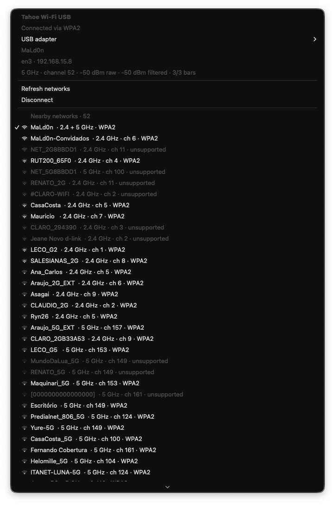
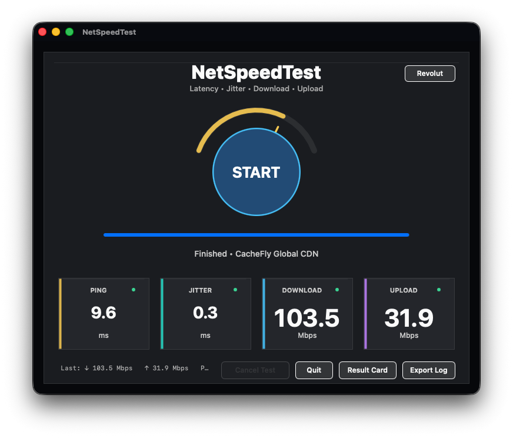

# Tahoe Wi-Fi USB — Realtek USB Wi-Fi for macOS Tahoe (Intel)

macOS development and adaptation by **MaLd0n**.

## About

Tahoe Wi-Fi USB is a community-driven project developing **experimental Realtek USB Wi-Fi support for Intel Macs running macOS Tahoe**, with a kernel extension and a menu-bar app. The goal is to document hardware compatibility, welcome testing on additional USB adapters and board revisions, and collaborate on expanding support. The project is under development; a successful build or a listed USB ID does not guarantee that a device works on actual hardware.

## Downloads

The macOS Intel (x86_64) kernel extension and menu-bar app are distributed as development pre-releases with SHA-256 checksums on [GitHub Releases](https://github.com/danielnmaldonado/TahoeRealtekWiFi/releases). Download the matching files and review the installation instructions and hardware testing limitations before use.

## Support the project

If you would like to support development and testing, the following funding links are available:

- [PayPal](https://www.paypal.com/donate/?hosted_button_id=AA4QBFJQYW2N2)
- [Ko-fi](https://ko-fi.com/olarila)
- [Revolut](https://revolut.me/olarila)
- [Remitly](https://remit.ly/pay/danielm2937)
- [Mercado Pago](https://mpago.la/2wFPzHP)

Funding options are also configured in [`.github/FUNDING.yml`](.github/FUNDING.yml). The repository's **Sponsorships** setting controls whether GitHub displays its Sponsor button.

## Tested USB Wi-Fi adapters and contributions

**Tested models:** **TP-Link Archer T9UH** and **TP-Link TL-WN822N**.

**Community collaboration is welcome.** This project invites contributors to test additional USB Wi-Fi adapters and hardware revisions, document real-world compatibility, report reproducible problems, and help add support for more devices and chipsets. Hardware tests, diagnostics, fixes, and pull requests are welcome.

To contribute, [open an issue](https://github.com/danielnmaldonado/TahoeRealtekWiFi/issues) with the adapter model, hardware revision, USB VID:PID, chipset (if known), macOS version/build, observed behavior (detection, scanning, WPA2, DHCP, traffic, reconnection, and sleep/wake), and relevant diagnostic logs. Remove personal information before sharing logs.

**Testing scope:** These two models were reported as tested by the project maintainer; their exact hardware revisions and full test results are not yet documented. Testing one unit does not establish compatibility with every revision, chipset, channel, or feature. This project remains under development.

Source code for a kernel extension (kext) and menu-bar application targeting macOS Tahoe on Intel Macs.
The driver and menu-bar app are **under development**. Successful builds and software tests do not replace connection and traffic testing on each USB adapter and board revision.

The driver exposes an Ethernet interface (`enX`), following the model used by itlwm.
The macOS-adapted net80211 stack handles association and WPA2-Personal/CCMP; the app selects a USB adapter, scans for networks, connects, and displays status. The control protocol does not depend on private AirPort classes.

## Screenshots

These are original application screenshots provided by the project owner. They illustrate an observed connection and one speed-test result, **not** a validation of every supported adapter or proof of which interface carried the speed-test traffic.

**Tahoe Wi-Fi USB — connection and nearby networks**



**NetSpeedTest — sample result**



## Implemented modes

These limits describe station-mode code. USB identity, ROM, silicon revision, RF paths, factory power limits, and endpoints are checked at initialization. All 13 operational backends are integrated into the controller.

| Family | Bands | Station mode |
|---|---|---|
| RTL8192CU | 2.4 GHz | 11b/g, 20 MHz |
| RTL8188EU | 2.4 GHz | 11b/g, 20 MHz; I-cut unsupported |
| RTL8192EU | 2.4 GHz | HT20/40, up to 2 spatial streams |
| RTL8192DU | 2.4 and 5 GHz | HT20; SMSP up to 2 spatial streams, DMDP 1 spatial stream per MAC |
| RTL8192FU | 2.4 GHz | HT20/40, up to 2 spatial streams |
| RTL8710BU | 2.4 GHz | HT20/40, 1 spatial stream; SMIC/UMC supported |
| RTL8723BU | 2.4 GHz | HT20, 1 spatial stream; Bluetooth coexistence controls |
| RTL8812AU | 2.4 and 5 GHz | HT20/40 and VHT20/40/80, up to 2 spatial streams |
| RTL8814AU | 2.4 and 5 GHz | HT20, up to 2 active spatial streams; RFE0/1 |
| RTL8821AU | 2.4 and 5 GHz | HT20/40 and VHT20/40/80, 1 spatial stream |
| RTL8821CU | 2.4 and 5 GHz | HT20, 1 spatial stream |
| RTL8822BU/CU | 2.4 and 5 GHz | HT20, up to 2 spatial streams |
| RTL8814BU | Station mode disabled | Dedicated HAL/USB and PHY; NIC firmware/protocol still pending |

In the current AU implementation, RTL8812AU accepts RFE 0–3 and RTL8821AU accepts RFE 0, subject to the documented ROM defaults. RTL8812AU boards with active Bluetooth remain blocked because the selected primary descriptor lacks the necessary coexistence callbacks. These board restrictions still apply when a USB ID appears in the catalog.

The 04bb:0959, 04bb:095a, and 0bda:2003 models follow their 5 GHz-only OEM configuration: they neither advertise nor permit transmission at 2.4 GHz.

Profiles use channels 1–11 at 2.4 GHz and non-DFS channels 36/40/44/48 and 149/153/157/161/165 at 5 GHz, subject to backend and ROM limits. DFS HT20 is also implemented on channels 52/56/60/64 and 100/104/108/112/116/120/124/128/132/136/140 for seven dual-band backends. ROM/RFE, factory country, and power restrictions may further narrow this set. The loaded driver advertises each channel group separately; the catalog alone does not authorize transmission. Channel 144 remains disabled.

DFS scanning is passive. A recent beacon matching the chosen BSSID/SSID/channel permits directed authentication; the driver enforces both local and AP-advertised power ceilings. CSA stops TX, takes down the link, and starts a new scan/WPA2 association. APs operating on wider channels use the implemented DFS20 path. Existing VHT40/80 support remains available on non-DFS channels in the corresponding AU backends. There is no AP mode, local CAC/radar detection, WPA3, or Wi-Fi 6/AX. See [DFS station support](docs/DFS-STATION.md).

PHY ceilings are not download/upload results. Actual throughput depends on the AP, signal, USB interface, and implemented features. CU/8188EU remain limited to 11b/g; 8814AU and B/C remain limited to HT20.

## Adapter catalog and release status

`data/legacy-usb-adapters.json` preserves 250 records from the original legacy package plus 20 extensions with provenance evidence. The inventory contains 270 IDs, 263 of which have a numeric match in a primary table. The seven remaining records have unconfirmed or conflicting identities and are not statically enabled. ID 13b1:0043 has a separate, restricted discovery path: the chipset is read before selecting B/C and checked again before power-up and firmware handling. The other cases are not enabled merely because their names look similar.

RTL8814B now has ported, dedicated HALMAC/USB, OTP, and codec components. Its station path remains blocked until licensed NIC firmware and protocol, factory/regulatory profile, remaining tracking functions, and physical tests have been qualified. See [RTL8814BU status](docs/RTL8814BU-STATUS.md). A similar product name does not justify using another chipset's HAL.

Of the catalog entries, 262 IDs are eligible for the 13 integrated backends. See the [complete adapter matrix](docs/USB-WIFI-ADAPTERS.csv) and [validation documentation](docs/). ID eligibility does not establish support for every commercial board revision using that ID. This source tree does **not** constitute a release qualification for all 270 records.

## Scanning and USB receive handling

Initial scans on dual-band backends finish the enabled passive channels before choosing an AP. The app displays all usable, observed bands when the same SSID appears at both 2.4 and 5 GHz; the driver selects the AP automatically.

USB RX handles zero-byte transaction errors with bounded endpoint recovery. When endpoint clearing fails transiently, the recovery logic retries with a finite delay and budget, drains old or partially rearmed reads, and only then rearms all four buffers. Synchronous RX submission failures take the same path. Diagnostics distinguish clearing, draining, and rearming. This recovery path is shared by all 13 station families; persistent failures and other errors still result in a safe stop. Recorded hardware recovery and WPA2 observations are preserved in the [changelog](CHANGELOG.md); they do not validate every board or channel.

## Explicit scans and measured signal

The app requests a real scan when **Refresh networks** is clicked, including while already connected. This may briefly trigger reassociation; background status polling remains read-only. Cached results must not be confused with a new radio scan.

The menu, tooltip, and accessibility labels show measured RSSI in dBm as well as the filtered reading. Signal bars retain their thresholds: the observed −44 to −42 dBm readings correspond to three bars. Native screenshots were checked at all three levels; no icon permanently stuck at maximum was found. Stale or unavailable readings are indicated.

The RTL8814AU HT20 path includes the channel-153 NBI/CSI adjustment found in the pinned Linux source. Scan counters distinguish visited channels and PHY observations from the network cache. The automatic router's 5 GHz channel had not yet been identified in the recorded test; these fixes alone do not establish physical 5 GHz connectivity.

## Review of the other families

RTL8192EU HT40/SGI/subchannel TX fields follow the primary Realtek setters while keeping RTS and retries separate. Frames using 20 MHz on an HT40 radio receive the correct subchannel. CU/8188EU retain their implemented modes and reject unported HT options.

RTL8812AU/RTL8821AU correct PHY-field positioning when a descriptor contains SHIFT, including signal measurements and firmware/coexistence consumers. The generic RX24 codec distinguishes the rtw88 layout from the legacy rtl8xxxu layout. RTL8192FU preserves the host 802.11 sequence for management, EAPOL, and data frames. AU/B-C coexistence preserves LNA requests while another MP query is pending, with bounded handling, stale-session rejection, and per-device state.

The review covered all 13 operational backends. A code review that finds no other confirmed defect does not replace hardware testing on actual boards.

## Collecting diagnostics

Double-click `WiFi-Diagnostics.command`. It uses standard macOS tools and does not require compiling the app or kext. The diagnostic directory and ZIP are written to `~/Library/Logs/Tahoe-WiFi-USB/Diagnostics/`; Terminal displays the resulting path.

`RTW-SUMMARY.txt` identifies each controller by Registry ID, family, VID:PID, and interface, and compares two readings of USB/RX/TX counters. Original properties and numeric JSON appear under `drivers/RTW-before/after`. These are IORegistry-published values and can be stale if the app has not queried that adapter. A delta of zero means two published values were equal; it does not prove that no errors or traffic occurred during collection. Diagnostics provide a per-controller publication generation and monotonic timestamp. An odd generation indicates publication in progress; IORegistry reads are not atomic. Older versions do not expose these markers.

Read failures and timeouts appear in `STATUS.tsv` without preventing ZIP creation. For AU adapters, the old `RTWDiagCalib*` counters do not measure calibration time.

The default collection does not require administrator rights, run a speed test, modify network/driver state, or read passwords or Keychain items. It applies the existing basic masking, including MAC addresses represented as data; review diagnostics before sharing. See help for `--output-dir`, `--minutes`, `--command-timeout`, and `--no-pause`.

## RTL8814AU: receive, transmit, and measured performance

AU RX now uses 32 KiB reads and buffers, consistent with the primary 20 KiB DMA threshold. The old 16 KiB path could truncate valid aggregates; other backends retain 16 KiB. New scalar diagnostics record the lengths of normal and failing reads without exporting packets.

TX AMPDU includes per-peer byte limits, per-TID BA, and descriptor fields checked against pinned sources. Management, EAPOL, group, and fragmented frames remain outside aggregation. The effective rate reported by firmware drives thermal tracking, rather than being overwritten with the initial descriptor rate on every transmission.

Recorded short WAN measurements on an earlier implementation were about 8.7 Mbps down and 8.9 Mbps up, with no reported recovery errors but with truncated/malformed RX frames. Subsequent recorded measurements ranged from 48.3–73.9 Mbps down and 42.0–55.2 Mbps up, without newly reported USB errors or truncation. These are historical samples, not PHY ceilings or a guarantee of performance on other hardware. See the [changelog](CHANGELOG.md) for the original build-specific records.

## TX queue handling and diagnostics

A full TX queue now retains packet ownership and requests a pause/retry from the IOKit output queue. An asynchronous wake occurs when capacity and authorization are available; a missing queue or terminated connection still results in a safe drop. This avoids admission losses under queue pressure without raising queue limits.

STATUS publishes HT/BA for backends that previously returned before legacy calibration, without executing AMRR or radio I/O. It also includes existing reorder/BA causes and per-controller publication markers. The fabricated fixed Ethernet speed of 54 Mbps was removed: without a complete, recent effective PHY rate, that value remains unknown.

In recorded tests, internal RX accounting advanced when packets were delivered while BSD reported zero. The delivery/flush return status is checked, and diagnostics expose the ingress boundary and native ifnet reading without duplicating counters. This does not prove that the zero BSD count was fixed or retrospectively explain the seven observed input errors. Physical validation with the driver loaded remains necessary.

The [complete per-chipset and VID:PID support list](docs/USB-WIFI-SUPORTE.txt) describes the 262 eligible identities, restrictions, and revisions. It does not constitute physical certification of all boards.

## Build instructions

Requirements: Intel Mac running Tahoe; full Xcode installation with the macOS 26 SDK; CMake; Python 3.10+; and C/C++ development tools. Node is used for an independent cryptographic check. The script fetches a pinned MacKernelSDK revision; that SDK is not bundled in the ZIP. Set `RTW_OFFLINE=1` to prohibit downloads and require a local SDK.

From the extracted source root:

```sh
bash ./build.command --all
```

`--all` builds the kext, app, and tests; `--kext`, `--app`, and `--tests` select individual stages. Products are placed in `Release/`. Source and delivery packages are written to `releases/` inside the project root, not to the Desktop. The scripts verify ad-hoc signatures but do not install or load the kext.

For native app tests covering AppKit, Keychain, and transport:

```sh
bash ./app/test.command
```

To package the app after building it:

```sh
bash ./app/package.command --no-build
```

The installer places `Tahoe Wi-Fi USB.app` in `/Applications` and installs its helper. The kext is placed in the EFI separately. The app can save passwords to the macOS Keychain. No personal password is required to build the project.

## Loading through Clover and Opencore

Identify the EFI partition that actually boots the computer. Back up the previous kext outside the injection directory and copy the entire bundle to the location for your bootloader.

**Clover:**

```text
Release/TahoeRealtekWiFi.kext
  → EFI/CLOVER/kexts/Other/TahoeRealtekWiFi.kext
```

**OpenCore:**

```text
Release/TahoeRealtekWiFi.kext
  → EFI/OC/Kexts/TahoeRealtekWiFi.kext
```

For OpenCore, enable a corresponding entry in `EFI/OC/config.plist` under `Kernel -> Add`, using `BundlePath: TahoeRealtekWiFi.kext`, `ExecutablePath: Contents/MacOS/TahoeRealtekWiFi`, and `PlistPath: Contents/Info.plist` for the built bundle. Preserve the existing kext load order and configuration. These instructions describe the bootloader setup; hardware operation must still be verified.

The copy will be used on the next boot through the correct EFI. The currently loaded driver remains in memory until then. The scripts do not restart the Mac or modify SIP, AMFI, Clover, or OpenCore configuration. See the [Clover instructions](docs/CLOVER.md).

## Verifying the result

Check the version/build, selected adapter, WPA2 authorization, IP address, and traffic on the corresponding USB interface. An `enX` interface or a loaded kext in IORegistry alone does not establish connectivity. When wired Ethernet is also connected, confirm which interface the speed test actually uses.

`rtw-backends --json` and `--adapters-json` describe capabilities present in the source; they do not query physical hardware. Legacy diagnostic firmware fields describe `rtw-legacy-fwdiag` only. The actual kext firmware loader uses its own backend. The old generic physical boot path is disabled.

## Source provenance and licenses

The source includes the app, helper, kext, net80211, cryptography, redistributable firmware, tests, generators, and license notices. See [source provenance](docs/SOURCES.md), the `*-Upstream.json` files, `firmware/*-provenance.json`, and licenses shipped beside each component. Embedded firmware blobs are unmodified binary images, **not** Realtek firmware source code.

Generators verify pinned primary inputs before overwriting output files. The release includes `SOURCE-MANIFEST.sha256` for source-integrity verification.
